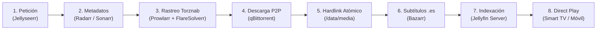

# Módulo 2 · Servidor Multimedia & Stack *Arr

Arquitectura completa, automatizada y de alto rendimiento para gestión, descarga, indexación y reproducción de contenido multimedia con **Jellyfin**, el ecosistema **Servarr** (Radarr, Sonarr, Prowlarr, Bazarr) y cliente **BitTorrent** con enlaces duros (*hardlinks*).

---

## 1. El Ciclo de Vida Automatizado (Las 8 Etapas)



1. **Petición**: El usuario busca una película o serie en la interfaz web de Jellyseerr desde su móvil o televisor y pulsa "Solicitar".
2. **Aprobación y Perfil**: Radarr o Sonarr reciben la solicitud y asignan un perfil de calidad (ej. 1080p Remux / WEBDL h265).
3. **Búsqueda e Indexación**: Prowlarr consulta múltiples trackers mediante protocolo Torznab. Si un tracker tiene protección Cloudflare Turnstile, FlareSolverr resuelve el reto automáticamente.
4. **Descarga**: El magnet se inyecta en qBittorrent bajo la categoría correspondiente (`movies` o `tv`).
5. **Hardlink Atómico**: Al finalizar la descarga, Radarr/Sonarr crean un *enlace duro* (*hardlink*) en `/data/media/movies/` con nomenclatura estandarizada. **Cero duplicación de espacio y cero tiempo de copia**.
6. **Subtítulos**: Bazarr detecta el nuevo archivo y descarga automáticamente subtítulos en español (.es) e inglés (.en).
7. **Notificación a Jellyfin**: Jellyfin actualiza su biblioteca al instante vía Webhook/API.
8. **Reproducción Directa (*Direct Play*)**: El cliente en Android TV, Apple TV o navegador reproduce el archivo de forma nativa sin transcodificación innecesaria.

---

## 2. La Regla de Oro: Enlaces Duros (*Hardlinks*) y TRaSH Guides

El error más común en servidores multimedia es montar volúmenes independientes para descargas (`/descargas`) y medios (`/peliculas`). Al hacer eso, Docker percibe dos sistemas de archivos distintos y realiza una **copia completa de bytes**, lo que:
- Duplica el espacio ocupado en disco.
- Degrada la vida útil del SSD por escrituras dobles.
- Causa picos de I/O de disco que ralentizan el sistema.

### Estructura Atómica Correcta (`/data`)
Todos los contenedores montan el directorio raíz único `/data`:
```
/srv/storage/data/
├── torrents/
│   ├── movies/      <-- Donde descarga qBittorrent
│   └── tv/
└── media/
    ├── movies/      <-- Donde apunta la biblioteca de Jellyfin y Radarr
    └── tv/          <-- Donde apunta la biblioteca de Sonarr
```
Gracias a que residen en el mismo inodo de sistema de archivos, el paso de `torrents/movies/` a `media/movies/` es un **hardlink atómico instantáneo** (0.01 segundos, 0 bytes adicionales).

---

## 3. Matriz de Puertos y Servicios

| Servicio | Puerto | Función | Acceso Recomendado |
|---|---|---|---|
| **Jellyfin** | `:8096` | Streaming multimedia y reproducción | Red Local / Tailscale |
| **Jellyseerr** | `:5055` | Portal de solicitudes y catálogo | Red Local / Cloudflare Tunnel |
| **Radarr** | `:7878` | Gestión de películas | Interno / Red Local |
| **Sonarr** | `:8989` | Gestión de series | Interno / Red Local |
| **Prowlarr** | `:9696` | Indexador de trackers Torznab | Interno / Red Local |
| **Bazarr** | `:6767` | Gestor de subtítulos | Interno / Red Local |
| **qBittorrent** | `:8080` | WebUI de descargas BitTorrent | Interno / Red Local |
| **FlareSolverr** | `:8191` | Evasión de Cloudflare en indexadores | Interno Docker |

---

## 4. Guía de Puesta en Marcha Paso a Paso

### Paso 1: Crear directorios
```bash
sudo bash scripts/setup_media_directories.sh /srv/storage/data
```

### Paso 2: Configurar variables y levantar contenedores
```bash
cp .env.example .env
docker compose up -d
```

### Paso 3: Configurar qBittorrent WebUI
1. Entra en `http://tu-servidor.local:8080` (usuario `admin`, contraseña temporal en logs de docker: `docker logs qbittorrent 2>&1 | grep "password"`).
2. En *Herramientas > Opciones > Descargas*:
   - Ruta de guardado por defecto: `/data/torrents`
   - Activar "Guardar archivos incompletos en": `/data/torrents/incomplete`
3. Crear categorías en el panel izquierdo:
   - Categoría `movies` -> Guardar en: `/data/torrents/movies`
   - Categoría `tv` -> Guardar en: `/data/torrents/tv`

### Paso 4: Configurar Prowlarr
1. Entra en `http://tu-servidor.local:9696`.
2. Añade tus trackers favoritos en *Indexers*.
3. En *Settings > Indexers > FlareSolverr*, añade:
   - Host: `http://flaresolverr:8191`
   - Tag: `flaresolverr` (asigna este tag a los trackers con protección Cloudflare).
4. En *Settings > Apps*, conecta Radarr (`http://radarr:7878`) y Sonarr (`http://sonarr:8989`) copiando sus respectivas API Keys. Prowlarr sincronizará automáticamente todos los indexadores.

### Paso 5: Conectar Radarr y Sonarr con qBittorrent
1. En Radarr/Sonarr ve a *Settings > Download Clients*.
2. Añade **qBittorrent**:
   - Host: `qbittorrent`
   - Port: `8080`
   - Category: `movies` (para Radarr) o `tv` (para Sonarr).
3. En *Settings > Media Management*:
   - Activa **Use Hardlinks instead of Copy**.

### Paso 6: Aceleración por Hardware en Jellyfin (Intel QuickSync / VA-API)
1. Entra en `http://tu-servidor.local:8096`.
2. Ve a *Administración > Panel de Control > Reproducción > Transcodificación*.
3. En *Aceleración de hardware*, selecciona **Intel QuickSync (QSV)** o **VA-API**.
4. Dispositivo VA-API: `/dev/dri/renderD128`.
5. Habilita decodificación por hardware para: H264, HEVC (8 y 10 bit), VP9, AV1 (si tu CPU lo soporta).
6. Activa *Tonemapping VPP* para reproducir contenido 4K HDR en pantallas SDR sin que los colores se vean lavados.
