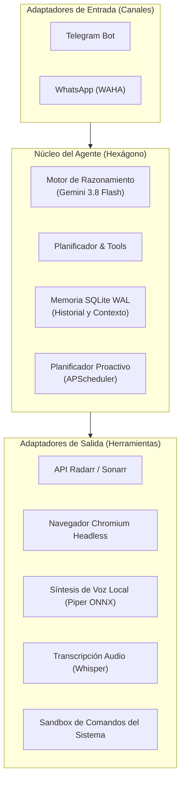

# Módulo 3 · Agente Autónomo Soberano en Linux (Sovereign Agent)

Guía completa para desplegar un agente inteligente autónomo, privado y soberano en tu servidor Linux. Inspirado en el patrón de dos niveles **Supervisor / Worker**, diseñado para operar 24/7 sin filtrar credenciales ni datos privados a nubes externas de terceros.

---

## 1. Arquitectura Hexagonal y Filosofía Soberana

El agente sigue una estricta **arquitectura hexagonal (puertos y adaptadores)**:



### Características Clave:
- **Supervisor / Worker Pattern**: El Worker (`sovereign-agent`) es un servicio residente en segundo plano que responde en Telegram y WhatsApp, ejecuta tareas programadas y vigila el servidor. El Supervisor actúa como ingeniero DevOps/SRE remoto para auditar logs, corregir código y lanzar pruebas.
- **Soberanía y Privacidad Absoluta**: Las sesiones del navegador web, tokens, cookies y datos de conversación residen en el disco local (`data/memory.db`) bajo SQLite con modo WAL (*Write-Ahead Logging*).
- **Control de Acceso Basado en Roles (RBAC)**: Solo los usuarios autorizados en la lista blanca con perfil `owner` pueden ordenar comandos críticos del sistema o manipular descargas.

---

## 2. Inferencia y Modelos de Lenguaje

El agente admite dos vías de inferencia sin comprometer la velocidad:
1. **API Directa de Google GenAI (`direct_api`)**:
   - Conexión HTTPS oficial mediante `GEMINI_API_KEY`.
   - Emplea `gemini-3.8-flash-high` para razonamiento profundo y `gemini-3.8-flash-low` para respuestas rápidas y enrutado de intenciones.
2. **Modo Proxy Local (`agy_proxy`)**:
   - Reutiliza la sesión autenticada de la CLI en el propio servidor (`agy --print`).
   - Ventaja: **Cero coste incremental por token** utilizando la cuota existente de suscripción personal.

---

## 3. Capacidades Multimedia: Voz y Oído en el Servidor

### 3.1. Síntesis de Voz Local (TTS Piper VITS ONNX)
- Motor por defecto: `piper_onnx` con modelo `es_ES-carlfm-high` (22.05 kHz).
- Ejecución 100% local en CPU x86_64 con un RTF de ~0.15 (sintetiza un audio de 10 segundos en 1.5 segundos, 6.5x más rápido que tiempo real).
- Pronunciación impecable de español de España con distinción fonética nativa (/θ/ vs /s/).

### 3.2. Transcripción de Audio en CPU (`faster-whisper`)
- Si envías una nota de voz por Telegram o WhatsApp, el agente la transcribe al instante con el modelo `large-v3-turbo` en precisión cuantizada `int8`.
- Cero dependencia de servicios de transcripción en la nube.

---

## 4. Opciones de Despliegue

### Opción A · Servicio Nativo en Segundo Plano (Recomendada con `systemd --user`)
La ejecución nativa permite que el agente invoque Playwright y herramientas del sistema de forma directa y fluida.

1. **Aprovisionar el entorno virtual**:
   ```bash
   bash scripts/setup_agent_environment.sh
   ```
2. **Configurar parámetros**:
   ```bash
   cp config/agent.example.yaml config/agent.yaml
   cp config/permissions.example.yaml config/permissions.yaml
   # Edita tus tokens y Chat IDs en config/agent.yaml
   ```
3. **Instalar la unidad systemd**:
   ```bash
   mkdir -p ~/.config/systemd/user
   cp systemd/sovereign-agent.service ~/.config/systemd/user/
   systemctl --user daemon-reload
   systemctl --user enable --now sovereign-agent.service
   ```
4. **Verificar estado y logs**:
   ```bash
   systemctl --user status sovereign-agent.service
   journalctl --user -u sovereign-agent.service -f
   ```

### Opción B · Despliegue Contenerizado con Docker Compose
```bash
docker compose up -d --build
```
El contenedor se ejecuta en modo `network_mode: host` para comunicarse sin fricción con los servicios locales (Jellyfin, Radarr, Sonarr y WAHA).
