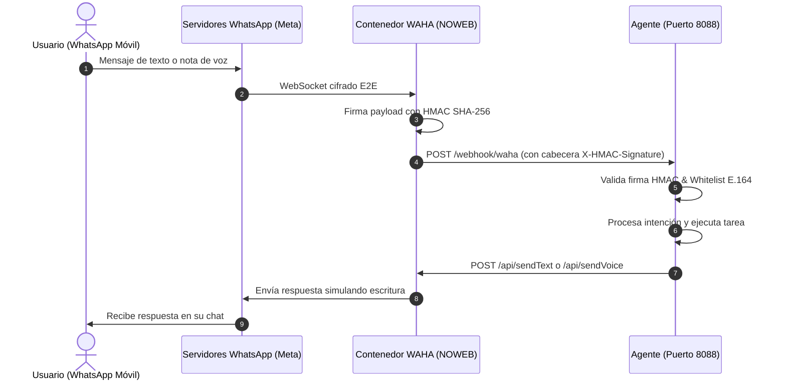

# Guía de Conexión y Hardening de WhatsApp (WAHA)

WhatsApp permite controlar tu servidor mediante la aplicación de mensajería más extendida en el ámbito personal. Para evitar el consumo excesivo de memoria RAM de un navegador Chromium tradicional y mitigar el riesgo de bloqueos por parte de Meta, utilizamos **WAHA (WhatsApp HTTP API)** con el motor **NOWEB (Baileys)**.

---

## 1. Arquitectura de Integración Segura



---

## 2. Puesta en Marcha de WAHA

1. Copia y edita las variables de entorno:
   ```bash
   cp .env.waha.example .env
   ```
2. Levanta el contenedor:
   ```bash
   docker compose -f docker-compose.waha.yml up -d
   ```
3. Accede al panel de control en tu navegador local:
   ```
   http://127.0.0.1:3000/dashboard
   ```
   Introduce el usuario y contraseña definidos en `.env`.
4. Pulsa en **Start Session** y escanea el código QR desde tu WhatsApp (*Ajustes > Dispositivos vinculados > Vincular un dispositivo*).

---

## 3. Prevención Activa de Baneos (Best Practices)

Meta monitoriza patrones automatizados para detectar bots no oficiales. Sigue estas directrices para mantener tu cuenta 100% segura:

1. **Simulación de Escritura Humana (`simulate_typing: true`)**:
   - El agente no debe responder en 5 milisegundos tras recibir un mensaje.
   - Envía el estado `"composing..."` (*escribiendo*) durante 1.5 - 3 segundos antes de disparar el mensaje final.
2. **Lista Blanca Estricta de Números (Formato E.164)**:
   - En `config/agent.yaml`, restringe el acceso exclusivamente a tu número (`allowed_phone_numbers`).
   - El agente ignorará en silencio cualquier mensaje de desconocidos o grupos no autorizados.
3. **No realizar envíos masivos (*spam*) ni listas de difusión**:
   - El canal debe utilizarse estrictamente en modalidad 1 a 1 entre tú y tu servidor.
4. **Validación Criptográfica HMAC SHA-256**:
   - Cada evento webhook recibido por el agente incluye la cabecera `X-HMAC-Signature`.
   - Si un paquete no coincide con `WHATSAPP_HOOK_HMAC_KEY`, se rechaza con un `401 Unauthorized`, impidiendo inyecciones de mensajes falsos desde la red local.
