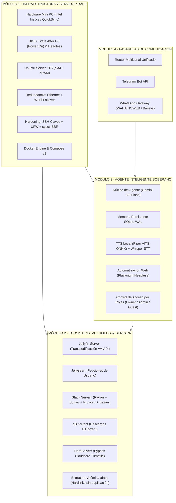

# Homelab Soberano Linux — Blueprint Modular 24/7

<p align="center">
  <strong>Guía maestra y suite modular para desplegar un servidor doméstico soberano, centro multimedia automatizado y agente inteligente privado en Linux x86_64</strong>
</p>

---

## 🌟 Visión y Filosofía

Este repositorio reúne y estructura de forma modular las mejores prácticas de ingeniería de sistemas, devops y arquitectura de software para construir un **servidor doméstico 24/7 sin dependencias de servicios de suscripción en la nube**.

- **Soberanía y Privacidad Absoluta**: Tus datos personales, descargas, sesiones de navegación e historiales de IA residen exclusivamente en tu propia máquina.
- **Eficiencia Energética y Coste Cero**: Diseñado para nodos x86_64 de bajo consumo (10W - 25W en reposo, como procesadores Intel de última generación o servidores compactos).
- **Desacoplamiento Modular**: Cada módulo es 100% independiente; puedes desplegar únicamente el servidor multimedia, únicamente el agente de IA o la suite completa.
- **Plantilla Genérica y Sanitizada**: Todo el contenido está desprovisto de credenciales personales, IPs privadas o nombres de usuario reales. Listo para ser clonado, compartido y adaptado por terceros.

---

## 🗺️ Arquitectura Global del Ecosistema



---

## 📦 Estructura de Módulos del Repositorio

El proyecto se organiza en 4 bloques de conocimiento autodirigidos:

| Módulo | Directorio | Descripción | Componentes Clave |
|---|---|---|---|
| **01** | [**Servidor Linux Base**](01-servidor-linux-base/README.md) | Preparación de hardware, BIOS, SO, hardening, red y Docker | AMI Aptio, ZRAM, UFW, Sysctl BBR, Failover Net |
| **02** | [**Servidor Multimedia**](02-servidor-multimedia/README.md) | Suite completa de gestión, descargas y streaming | Jellyfin, Radarr, Sonarr, Prowlarr, qBittorrent, Hardlinks |
| **03** | [**Agente Soberano Linux**](03-agente-soberano-linux/README.md) | Agente autónomo soberano con IA local, voz y herramientas | Gemini 3.8 Flash, Piper TTS ONNX, Playwright, RBAC |
| **04** | [**Pasarelas de Mensajería**](04-pasarelas-comunicacion/README.md) | Conexión con Telegram Bot y WhatsApp Web sin navegador | BotFather, WAHA NOWEB, HMAC Webhook, Anti-Baneo |

---

## 🚀 Guía de Inicio Rápido (3 Pasos)

### 1. Clonar el repositorio y preparar variables de entorno
```bash
git clone https://github.com/tu-usuario/homelab-soberano-linux.git
cd homelab-soberano-linux
cp .env.example .env
# Adapta tus rutas de almacenamiento y claves maestras en .env
```

### 2. Aprovisionar el servidor base (Módulo 1)
```bash
cd 01-servidor-linux-base
sudo bash scripts/01_bootstrap_server.sh
```

### 3. Levantar la suite multimedia o el agente inteligente
- **Para la suite multimedia (Módulo 2)**:
  ```bash
  cd ../02-servidor-multimedia
  sudo bash scripts/setup_media_directories.sh /srv/storage/data
  docker compose up -d
  ```
- **Para las pasarelas de comunicación (Módulo 4)**:
  ```bash
  cd ../04-pasarelas-comunicacion
  cp .env.waha.example .env
  docker compose -f docker-compose.waha.yml up -d
  ```
- **Para el agente soberano (Módulo 3)**:
  ```bash
  cd ../03-agente-soberano-linux
  bash scripts/setup_agent_environment.sh
  systemctl --user enable --now sovereign-agent.service
  ```

---

## 🔒 Privacidad y Seguridad por Diseño

1. **Cero Secretos en el Repositorio**: El archivo `.gitignore` previene que se comiteen claves `.env`, bases de datos SQLite, tokens o credenciales reales.
2. **Aislamiento en Red Local**: Los paneles de administración críticos (`Prowlarr`, `Radarr`, `Sonarr`, `WAHA`) se mantienen vinculados a `127.0.0.1` o accesibles únicamente mediante túneles Zero-Trust cifrados (Cloudflare Tunnel o Tailscale).
3. **Control Criptográfico HMAC**: Los mensajes entrantes desde WhatsApp se verifican contra un hash HMAC SHA-256 para prevenir ataques de suplantación.

---

## 🤖 Guía de Contexto para Modelos de IA y Agentes Autónomos

Si eres un modelo de lenguaje (LLM), agente autónomo o asistente de código que está indexando o asistiendo en este repositorio:
- Consulta el archivo [**AGENTS.md**](AGENTS.md) en la raíz del proyecto para una descripción estructurada del mapa arquitectónico, convenciones de nombres, límites de seguridad y guía de razonamiento rápido para cada módulo.
- Todos los servicios están desacoplados mediante variables de entorno en `.env.example`.
- Nunca introduzcas nombres comerciales de hardware específico ni identidades personales en commits o extensiones de código.

---

*Desarrollado para la comunidad como plantilla de referencia de Homelab Soberano.*
